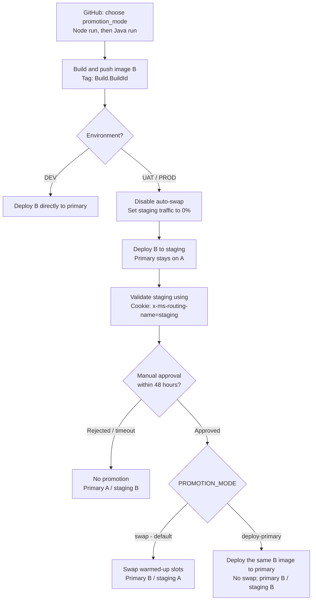

## Blue-green deployment

The Azure DevOps pipeline [`.devops/deploy-pipelines.yml`](./.devops/deploy-pipelines.yml)
deploys DEV directly. For UAT and PROD it:

1. Disables auto-swap and explicitly sets staging traffic to **0%**.
2. Deploys the image tagged with `Build.BuildId` to the existing `staging` slot.
3. Waits for manual approval in Azure DevOps (expires after two days with rejection).
4. Promotes the approved image using the selected `PROMOTION_MODE`.

Select `promotion_mode` when starting the GitHub **Release And Deploy** workflow.
The same value is passed to the separate Node and Java Azure DevOps runs. When
starting Azure DevOps directly, use its `PROMOTION_MODE` parameter. Both default
to `swap`; DEV always deploys directly to primary and ignores this selection.

| Promotion mode | Action after approval | Slots after successful promotion |
|---|---|---|
| `swap` (default) | Swap the warmed-up staging slot with primary | Primary: candidate B; staging: previous version A |
| `deploy-primary` | Deploy the same image tagged with `Build.BuildId` to primary, without rebuilding or swapping | Primary and staging: candidate B |

Updating primary containers can cause downtime depending on the App
Service configuration, and the previous version is not kept in staging for an
immediate swap rollback.

The following flow applies to each service independently (Node, then Java):



The App Service plan must support deployment slots, the `staging` slot must already
exist, and the Azure service connection must be allowed to configure routing,
deploy to slots and swap them. Keep slot-specific settings and dependencies
configured on the appropriate slot. Do not run overlapping deployments for the
same App Service while approval is pending: they share the staging slot.

Before approving, select staging on the **production App Service hostname** by
sending this HTTP header on every test request:

```http
Cookie: x-ms-routing-name=staging
```

For example:

```bash
curl --fail-with-body \
-H 'Cookie: x-ms-routing-name=staging' \
'https://<app-service-production-hostname>/info'
```

The explicit 0% rule enables manual slot selection without randomly sending
normal production traffic to staging. Use `Cookie: x-ms-routing-name=self` to
explicitly select production. This is a cookie in the `Cookie` header, **not**
a standalone `x-ms-routing-name` header.

If requests go through APIM or another proxy, it must forward the cookie to App
Service and bypass caching for staging requests. Slot selection is not an
authorization mechanism; existing authentication and access restrictions still
apply. For each PDF generation request, Java checks the incoming `Cookie` header.
Only when it contains `x-ms-routing-name=staging`, Java sends
`Cookie: x-ms-routing-name=staging` on the corresponding Node generation request.
Other cookies are not forwarded. Missing cookies or other routing values keep
the existing Node behavior (no routing cookie). The selection is request-scoped,
including on the shared HTTP client; it is not retained for subsequent requests.
No environment variable is needed. Java `/info` returns local application
information and does not call Node.

Keep the Java staging slot's Node endpoint settings pointed at the **production
Node hostname** (or an APIM route forwarding the cookie to it); the cookie selects
Node staging. Both Node staging and its explicit 0% routing rule must exist
before testing. Any proxy between the client and Java must preserve the routing
cookie so Java can read it. The GitHub release
workflow still deploys and approves Node and Java separately, not as an atomic
two-service release.

Rejection or timeout leaves production unchanged and keeps the candidate in
staging for inspection. In `swap` mode, staging contains the previous production
version after promotion: remove the staging cookie (or select `self`) to test
the promoted version. An authorized operator can roll back by swapping the slots
again, provided staging has not been overwritten by another deployment.
In `deploy-primary` mode, both slots run the candidate image after successful
promotion, so keeping the staging cookie still selects the candidate. A rollback
requires redeploying a previous image; swapping the aligned slots does not restore
the previous version.

See [App Service slot traffic routing](https://learn.microsoft.com/en-us/azure/app-service/deploy-staging-slots#route-production-traffic-manually).